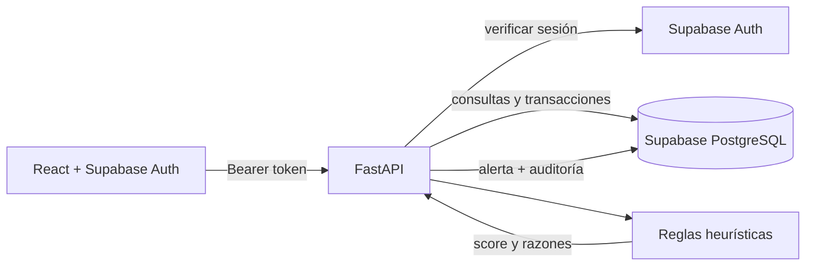

# Arquitectura y garantías

## Componentes

- Portal React SPA: interfaz y token de sesión con Supabase Auth. No lee PostgreSQL directamente.
- API FastAPI: única superficie de acceso a datos y lógica de riesgo; controla RBAC y registra auditoría.
- PostgreSQL de Supabase: tablas transaccionales y de casos, con conexión desde un rol del servidor. Los usuarios finales no reciben credenciales ni consultan tablas.
- Render: Static Site + Python Web Service independientes.

## Modelo de seguridad

Cada llamada privada se autentica verificando el token de acceso con el endpoint de usuario de Supabase Auth. Los roles se obtienen en el servidor, jamás de una cabecera entregada por el navegador. El primer usuario con correo verificado exactamente igual a `ADMIN_EMAIL` recibe privilegios de administrador. Otros usuarios ingresan como `pending` (sin permisos de lectura) y solo el administrador puede habilitarlos. Para entornos reales: desactivar altas públicas en Supabase y habilitar invitaciones controladas. La API no proporciona registros de usuario ni lectura pública de tablas.

La cuenta PostgreSQL del backend se configura en `DATABASE_URL` y se guarda únicamente en Render (servidor). Si se expone PostgREST/Data API para esquemas públicos de Supabase, se deben aplicar RLS y revocar permisos públicos; este proyecto asume todo el acceso por la API FastAPI. Se recomienda crear un rol de Postgres con privilegios mínimos antes de tratar datos reales.

## Evaluación de riesgo

Se implementa un score heurístico **explicable**, basado en: alto importe, velocidad 24h, patrón de importes similares, nueva contraparte y transferencia recíproca. Produce alertas cuando la puntuación es >=30. Los pesos y los umbrales NO representan normas SBS/UIF ni estimaciones empíricas de probabilidad. El motor NO calcula aprendizaje automático y no debe presentarse como tal. Para validarlo con datos reales se necesitan privacidad, acuerdos de acceso, consentimiento/base legal, calibración por perfil, sets etiquetados y evaluación independiente.

## Alcance y limitaciones verificables

- No hay integración bancaria, UIF, PEP ni listas de sanciones; no se anuncian dichas integraciones.
- No hay reglas dinámicas editable desde UI; la pantalla es un catálogo de reglas del backend.
- La red visualiza máximo 150 cuentas y 350 operaciones recientes, no es un motor de grafos distribuido.
- El módulo importa CSV de máximo 500 filas / 1 MB, con rollback completo ante una fila incorrecta.
- No se ejecutan transacciones financieras reales, solo se analizan registros.
- `Base.metadata.create_all()` genera tablas nuevas, pero no migra modificaciones posteriores. Para operación sostenida agregar Alembic y migraciones versionadas.
- La seguridad y calidad deben ser auditadas antes del tratamiento de datos bancarios reales; esto es un producto funcional para un entorno de hackathon, no una solución certificada para una entidad supervisada.
- El cierre `CLOSED_CONFIRMED` es una decisión documental interna; no constituye confirmación del delito ni reporte regulatorio.

## Diagrama de flujo

